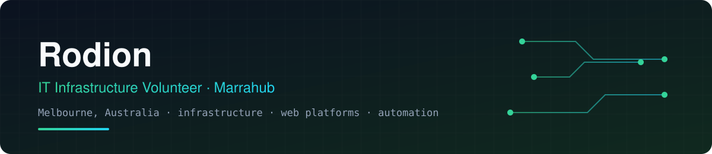

---

## 👋 About

Hi, I'm Rodion, originally from Ukraine and now based in Melbourne.

I volunteer as an **IT Infrastructure Volunteer at [Marra Community Hub Incorporated](https://marrahub.com.au)** (Marrahub), a community organisation. I keep the systems behind it running and help the team ship.

## 🏘️ What I work on at Marrahub

| Area | What that means in practice |
|---|---|
| **Platforms** | The community hub and B2B portal: features, fixes, reviews |
| **Infrastructure** | Cloud hosting, Cloudflare, databases, access control |
| **CI/CD** | GitHub Actions pipelines, deployments, release hygiene |
| **Team support** | Onboarding developers, access and permissions, documentation |

## 🧩 Tech I use

<b>More detail</b>

| Area | Tools |
|---|---|
| Languages | Python, TypeScript, JavaScript, Rust |
| Web | React, Vite, Node.js |
| Data | PostgreSQL, SQLite |
| Cloud & edge | Cloudflare (Workers, Pages, Access), Azure |
| Delivery | GitHub Actions, Docker |
| Local AI | Ollama and local LLM tooling |

## 📫 Contact

For Marrahub work, the quickest way to reach me is through the organisation's repositories or via [marrahub.com.au](https://marrahub.com.au).

